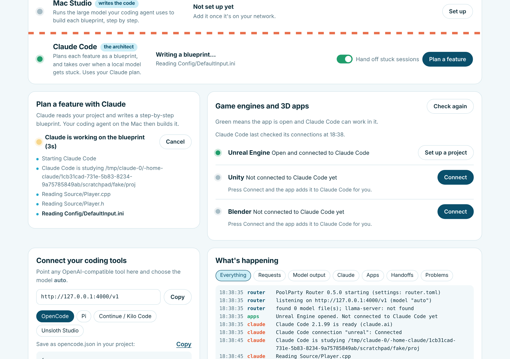

# PoolParty Router

**Claude plans, your Mac codes, your PC runs the engines.** PoolParty Router
connects Claude Code, a big-memory machine and your PC's graphics card. Claude
Code writes a blueprint for each feature, the coding agent on the Mac builds it
through the router, and your GPU stays free for Unreal, Unity and Blender, with a
status light for each showing whether it's connected to Claude.



🌊 [Website](https://guinnessstache.github.io/poolparty-router/) · ⬇️ [Download for Windows](https://github.com/Guinnessstache/poolparty-router/releases/latest/download/PoolParty-Router-windows-x64.zip)

## What it does

| Machine | Typically | Gets |
| --- | --- | --- |
| **Claude Code** (the architect) | Your Claude Pro or Max plan | Blueprints for each feature; sessions where the local model is stuck |
| **Remote machine** (writes the code) | A big-memory box (e.g. Mac Studio) running a large model | Coding agents, long chats, images |
| **This PC** (runs the engines) | A gaming GPU (e.g. RTX 4070 Ti) | Unreal, Unity and Blender; a small model for tab completion when they're closed |

- **Plan with Claude:** pick a project folder, describe a feature, and Claude Code
  reads the project and writes `BLUEPRINT.md` (goal, how it fits, build steps,
  engine notes, risks). The app also points OpenCode in that folder at the router
  and gives you the instructions to paste so the Mac builds it step by step.
- **Engine and 3D app lights:** Unreal, Unity and Blender each show whether they're
  open, whether their MCP server is running, and whether Claude Code is connected.
  **Connect** adds them to Claude Code (copying the setup from the Claude desktop
  app when it has one), and **Set up a project** makes an Unreal project start its
  MCP server on its own.
- **GPU hand-back:** while an engine is open, this PC's model pauses so the engine
  gets the whole GPU, and restarts when they close.
- **Status lights and plain-English status** for every machine.
- **One-click model control:** the app finds your GPU, `llama-server` and the
  models already on your PC, shows which ones fit, and starts or stops the model for you.
- **Live traffic map** of your PC, GPU, remote machine and Claude Code, with
  tokens per second on each connection.
- **"What's happening" log** with filters for requests, model output, handoffs
  and problems.
- **Claude handoffs:** when a coding agent keeps hitting the same build error, the
  router writes a short brief and tells you the one command to continue in Claude Code.
- Starts with Windows if you want it to, and adds itself to the Start menu.

## Get started (Windows)

1. [Download the zip](https://github.com/Guinnessstache/poolparty-router/releases/latest/download/PoolParty-Router-windows-x64.zip),
   unzip it anywhere, and open **PoolParty Router**. Windows may warn that the
   app is unsigned: choose **More info → Run anyway**.
2. Pick a model for this PC and press **Use this model**. The app looks in LM
   Studio's, Hugging Face's and your Downloads folders. If it can't find
   `llama-server`, it tells you where to get it.
3. Optional: under **Mac Studio**, press **Set up**, type the machine's name or IP
   address, press **Test**, then **Save**.
4. Under **Game engines and 3D apps**, press **Connect** next to each app you use.
   Claude Code must be installed and signed in once (run `claude` in a terminal).
5. Copy the address from **Connect your coding tools** into OpenCode, Pi, Continue,
   Kilo Code or Unsloth Studio and choose the model **auto**. The app shows a
   ready-to-paste config for each.

### Setting up a Mac Studio as the remote machine

On the Mac: `brew install llama.cpp`, copy the `mac` folder from the zip over, and run

```bash
./mac/setup-mac.sh ~/models/<your-model>.gguf
```

It raises macOS's GPU memory limit (to 112 GB on a 128 GB Mac) at every boot,
starts `llama-server` at login with a password, and prints the address and
password to type into the app. `mac/uninstall-mac.sh` undoes it.

## Planning a feature

1. In **Plan a feature with Claude**, choose the project folder and describe the
   feature in a sentence or two. Pick **Opus** for the hardest designs.
2. Claude Code runs read-only in that folder (it can read and search files and the
   web, but not change anything) and the steps appear live.
3. The result is saved as `BLUEPRINT.md` (the previous one is kept as
   `BLUEPRINT.previous.md`).
4. Open OpenCode in the project, paste **Copy build instructions**, and the
   coding agent on the Mac works through the build steps.

## How requests are routed

1. Model `local` or `remote` → that machine.
2. No remote machine set up yet → this PC takes everything.
3. Tab completion (`/v1/completions`, `/infill`, or `max_tokens` ≤ 64) → this PC.
4. Coding agents (requests with tools), chat and images → the remote machine.
5. Remote machine offline → chat falls back to this PC; agent turns get a clear
   error instead of a much weaker model.
6. Prompt bigger than any loaded model can hold → handoff to Claude Code.

Every reply carries `x-poolparty-node` and `x-poolparty-rule` headers saying where
it went and why.

## When a session gets handed off

A coding session gets a strike when:

| Signal | Strikes |
| --- | --- |
| The same build or test error comes back (line numbers and paths ignored) | 1 per repeat |
| A tool call whose arguments aren't valid JSON | 1 |
| The exact same tool call three times in a row | 2 |

At three strikes (adjustable), the router writes a brief to the handoff folder
(the task, why it was handed off, what was tried, summarized by a local model,
and the last failing output) and replies to the agent with the command to run:

```
claude "Read C:\...\handoff_2026-10-13_175731_knight.md and take over the task it describes."
```

Claude Code runs on your Claude plan, so a Pro plan is enough. Only output from
command-style tools (bash, shell, test, build…) counts, so reading source files
full of the word "error" doesn't trigger anything. Output that shows success
clears the strikes.

## Checking it works

`SETUP-AND-TEST.cmd` runs 12 automatic checks against your own hardware: routing,
streaming, a stuck session handing off, the pause switch, the hand-off button,
and what happens with the remote machine offline. It writes `test\report.txt`.
`STOP.cmd` shuts it down.

## Settings

The app saves its settings in `%APPDATA%\PoolParty Router\router.toml`; you never
need to edit it, but [router.example.toml](router.example.toml) documents every
option. Handoff briefs and the log file live in the same folder.

**Security:** the router listens on `127.0.0.1` only. To use it from other
machines, add your Tailscale IP to `listen` and set `api_key`. The buttons that
start programs or open folders only work from the PC itself unless `api_key` is set.

## API

| Endpoint | Purpose |
| --- | --- |
| `POST /v1/chat/completions`, `/v1/completions`, `/infill` | Routed requests (streaming passes straight through) |
| `GET /v1/models` | `auto`, `local`, `remote` |
| `GET /status` | Machines, model state, traffic, sessions, recent requests |
| `GET /router/events` | Live Server-Sent Events: log lines, traffic ticks, requests, handoffs |
| `POST /router/escalate` | Hand off a session (`{"session": "<id>"}`, or the latest) |
| `POST /router/mode` | `{"paused": true}` pauses handoffs |
| `GET /router/claude`, `POST /router/claude/refresh` | Claude Code status, its MCP connections, and the app lights |
| `POST /router/apps/connect` | `{"app": "unreal" \| "unity" \| "blender"}` adds the app to Claude Code |
| `POST /router/apps/unreal-setup` | `{"project": "<folder>"}` enables Unreal's MCP plugins and auto-start |
| `GET/POST /router/blueprint`, `POST /router/blueprint/cancel` | Write a blueprint with Claude Code and follow its progress |

## Building from source

Requires Rust. `cargo build --release` produces `target/release/poolparty-router`.
Run it with `--background` to skip opening the window, or pass a settings file path.
Release builds on Windows are windowed apps with no console. GitHub Actions builds
the Windows zip for every tagged release.

## Credits

Models run in [llama.cpp](https://github.com/ggml-org/llama.cpp)'s `llama-server`.
PoolParty Router is a companion to [PoolParty](https://github.com/Guinnessstache/poolparty).
MIT licensed.
